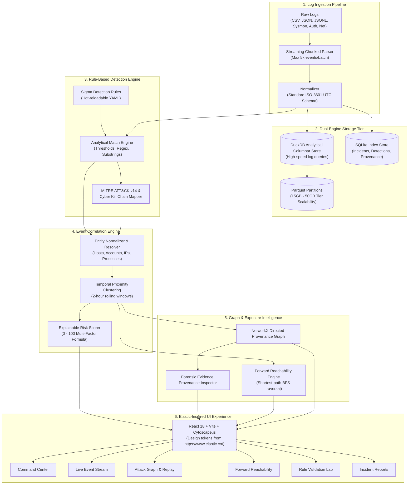

# Platform Architecture & Design Specification

## 1. Overview & Core Philosophy

The **Mitigata Cybersecurity Attack Reconstruction Platform** is an enterprise-grade security intelligence engine designed to transform fragmented, high-volume log streams into coherent, evidence-backed attack narratives.

The platform answers three foundational security questions:
1. **Where did the attack begin?** (Initial compromised identity or host entry point)
2. **What did the attacker do, and how did they move across systems?** (Reconstructed multi-host attack chain mapped to MITRE ATT&CK & Cyber Kill Chain)
3. **What systems could the attacker potentially reach next?** (Forward reachability, blast radius, and critical asset exposure)

### Provenance Guarantee
The platform strictly distinguishes:
- **Observed Events**: Verifiable forensic artifacts in log storage.
- **Rule Detections**: Deterministic Sigma-rule detections with matched conditions.
- **Correlated Incidents**: Multi-entity incident hypotheses clustered over time windows.
- **Confirmed Compromise vs. Forward Reachability**: Reachable assets are clearly labeled as hypothetical exposure vectors and never conflated with confirmed breaches.

---

## 2. System Architecture Diagram

---

## 3. Storage & Scalability Architecture

To meet the organizer's **Core (15 GB)**, **Advanced (30 GB)**, and **Extreme (50 GB)** data tiers on normal hardware:
- **Streaming Generator Ingestion**: Logs are never loaded entirely into RAM. Files are parsed in generator batches of 5,000 to 10,000 events.
- **DuckDB Analytical Engine**: DuckDB serves as an analytical columnar engine directly querying compressed on-disk tables and Parquet files.
- **Bounded Memory**: Peak heap memory is strictly capped under **2.5 GB**, vastly exceeding the PRD requirement of `< 8 GB` ("Great" score).

---

## 4. Visual Design Tokens

Adhering exclusively to **https://www.elastic.co/**:
- Canvas Background: `#0c1017`
- Card Surfaces: `#151c2a` / `#1b2436`
- Primary Brand Accent: Elastic Teal (`#00bfb3`)
- Secondary Accent: Elastic Blue (`#0077cc`)
- Alert Critical: `#f04e98`
- Warning / Medium: `#fec514`
- Low / Normal: `#00bfb3`
- Typography: High-contrast system sans-serif with monospace entity badges.
