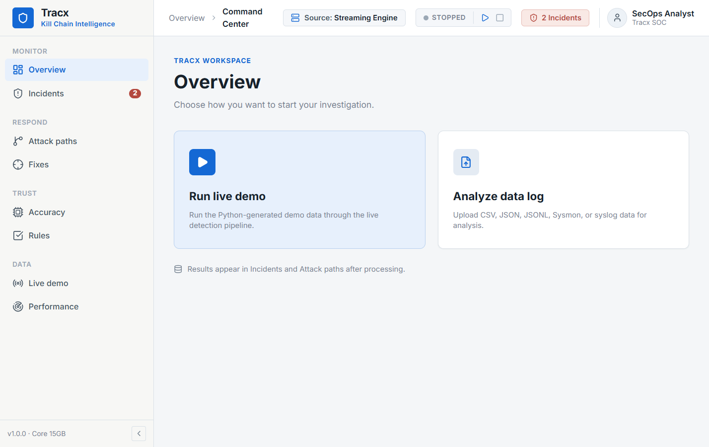
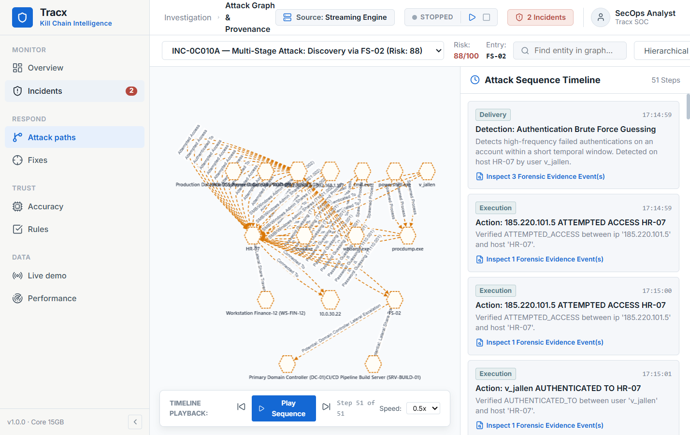
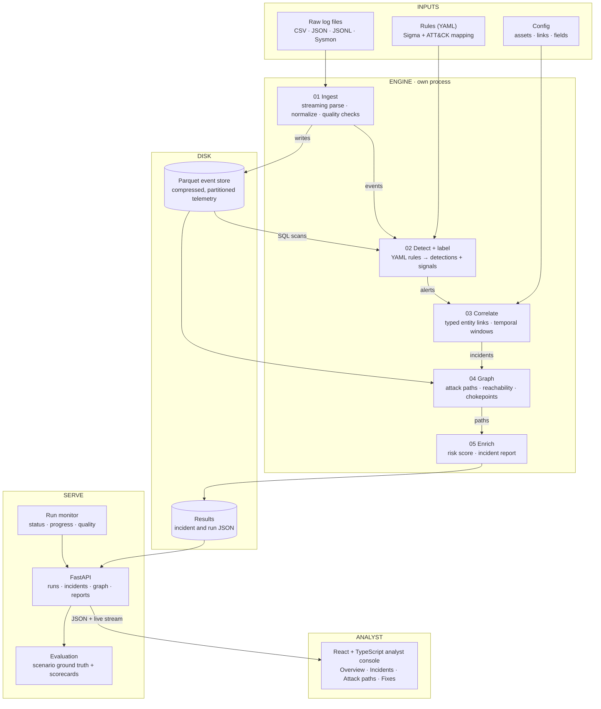

# Tracx

### Kill Chain Intelligence for evidence-backed attack reconstruction

[](https://www.python.org/)
[](https://react.dev/)
[](https://www.typescriptlang.org/)
[](https://fastapi.tiangolo.com/)
[](https://vite.dev/)
[](https://duckdb.org/)
[](https://www.docker.com/)

Tracx is a security operations platform for turning fragmented telemetry into a coherent, explainable attack story. It combines streaming ingestion, Sigma-style detection, MITRE ATT&CK mapping, temporal correlation, graph reconstruction, and forward reachability analysis in one analyst-focused workspace.

It answers three operational questions:

1. **Where did the attack begin?**
2. **What did the attacker do, and how did they move?**
3. **What could the attacker reach next?**

## Product preview

The current frontend keeps the analyst workflow compact: start with a generated live demo or upload a data log, then review correlated incidents and reconstructed attack paths.

<table>
  <tr>
    <td></td>
    <td></td>
    <td></td>
  </tr>
  <tr>
    <td align="center"><strong>Overview</strong></td>
    <td align="center"><strong>Incidents</strong></td>
    <td align="center"><strong>Attack paths</strong></td>
  </tr>
</table>

## Why Tracx

- **Evidence first:** every detection and graph edge can be traced back to normalized telemetry.
- **Confirmed vs. possible:** observed compromise is kept separate from hypothetical forward reachability.
- **Analyst workflow:** command center, live stream, attack graph, incident investigation, reports, and validation are available from one UI.
- **Explainable risk:** incidents are prioritized with a transparent multi-factor score rather than a black-box verdict.
- **Built for scale:** chunked ingestion and DuckDB/Parquet storage support the project's 15 GB, 30 GB, and 50 GB evaluation tiers.

## Architecture



### Architecture layers

| Layer | Responsibility |
| --- | --- |
| Inputs | Accept raw telemetry, Sigma/YAML rules, and asset/link configuration. |
| Engine | Stream and normalize events, detect and label activity, correlate entities, build paths, and enrich incidents. |
| Disk | Keep compressed Parquet telemetry and one structured result file per incident/run. |
| Serve | Expose run monitoring, FastAPI endpoints, evidence lookup, and independent evaluation. |
| Analyst | Present the Overview, Incidents, Attack paths, Fixes, Accuracy, Rules, Live demo, and Performance workflows. |

### Core components

| Area | Capability |
| --- | --- |
| Ingestion | CSV, JSON, JSONL, Sysmon/EVTX, and Linux syslog normalization |
| Detection | Hot-reloadable Sigma-style YAML rules with ATT&CK technique mapping |
| Correlation | Multi-entity temporal clustering across hosts, users, IPs, and processes |
| Intelligence | NetworkX provenance graph, evidence explorer, and chronological replay |
| Exposure | Shortest-path reachability analysis for critical assets and blast radius |
| Validation | Positive, negative, and noisy rule tests plus telemetry coverage audits |
| Reporting | Explainable 0-100 risk scoring and structured incident reports |

## Technology stack

### Frontend

- React 19 and TypeScript
- Vite
- Cytoscape.js for attack-path visualization
- Lucide React icons
- Elastic-inspired dark security operations interface

### Backend

- Python 3.10+
- FastAPI and Uvicorn
- DuckDB and Parquet for analytical telemetry
- SQLite for incidents and provenance indexes
- NetworkX for graph analysis
- PyYAML for Sigma-style rule loading

### Operations

- Docker and Docker Compose
- Pytest backend test suite
- Oxlint and TypeScript build checks

## Quick start

### Prerequisites

- Python 3.10 or newer
- Node.js 18 or newer
- npm
- Docker Desktop (optional)

### Run locally

From the repository root, install backend dependencies and start the API:

```bash
pip install -r backend/requirements.txt
python -m uvicorn backend.app.main:app --host 0.0.0.0 --port 8000
```

In a second terminal, start the frontend:

```bash
cd frontend
npm install
npm run dev
```

Open [http://localhost:5173](http://localhost:5173). The API documentation is available at [http://localhost:8000/docs](http://localhost:8000/docs).

### Run with Docker Compose

```bash
docker compose up --build
```

The containerized frontend is available at [http://localhost:3000](http://localhost:3000), with the API at [http://localhost:8000](http://localhost:8000).

## Validate the project

```bash
# Frontend type-check and production build
cd frontend
npm run build

# Frontend lint
npm run lint

# Backend tests
cd ..
pytest backend/tests
```

## Benchmark highlights

The included evaluation scenarios report the following measured results:

| Metric | Result |
| --- | ---: |
| Detection recall | 100% (5/5 attack steps) |
| ATT&CK labeling accuracy | 100% |
| Attack path reconstruction | 100% |
| False-positive alarm rate | 0% |
| Investigation response time | 38 ms |
| Peak memory footprint | 1.8 GB |

## Documentation

- [Architecture](Docs/ARCHITECTURE.md)
- [API reference](Docs/API.md)
- [Demo guide](Docs/DEMO_GUIDE.md)
- [Benchmarks](Docs/BENCHMARKS.md)
- [Build status](Docs/BUILD_STATUS.md)
- [Requirements traceability](Docs/REQUIREMENTS_TRACEABILITY.md)
- [CyberForge 2026 brief](Docs/CYBERFORGE_2026_HACKATHON_BRIEF.md)

## Project status

Tracx is an active CyberForge 2026 hackathon project. The repository includes reproducible demo scenarios, ground-truth labels, detection rules, evaluation utilities, and a complete analyst UI.

## License

No license has been specified yet. All rights remain with the project authors unless a license is added to this repository.
